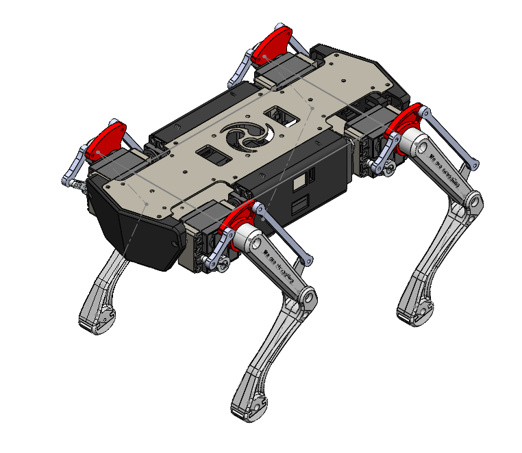
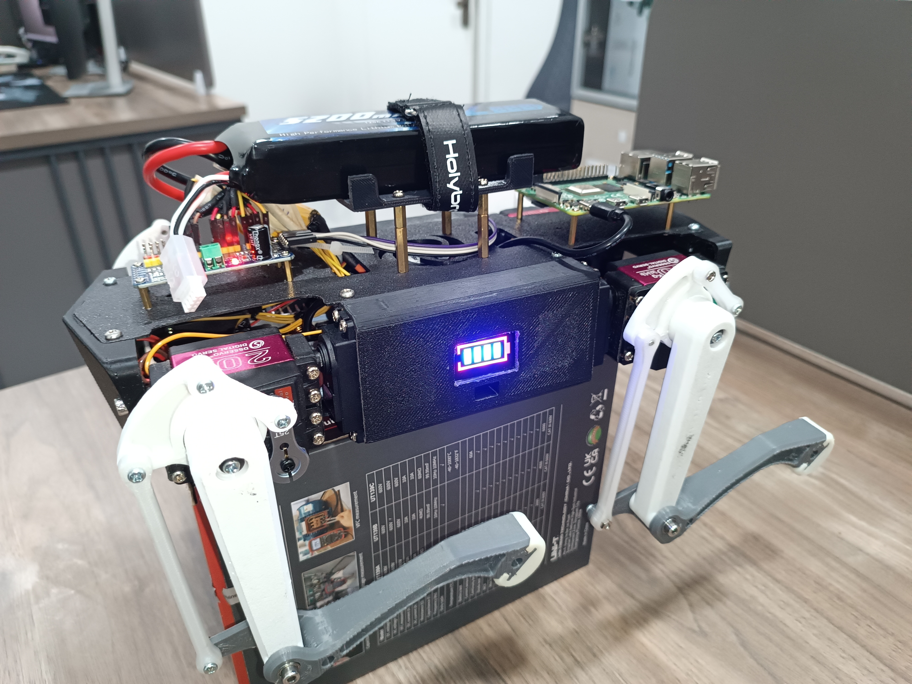

# Quadruped Robot — 12-DOF Electronics Design

A 3D-printed, 12-degree-of-freedom quadruped robot built as a legged-locomotion platform, with custom electronics for actuation and power distribution. It integrates a Raspberry Pi 4B, a dedicated I2C servo controller, and a multi-rail buck-converter power system sized against worst-case servo load.



**Features:**
- 12-DOF quadruped platform (4 legs × 3 joints: hip, thigh, shin)
- Raspberry Pi 4B main controller, I2C/PWM servo control
- Custom multi-rail power distribution sized via load-current analysis
- 3D-printed ABS/PLA chassis, compact benchtop footprint
- Dedicated cooling for sustained servo/electronics load

## System Overview

The robot is a four-legged platform with three actuated joints per leg (hip, thigh/upper-leg, shin/lower-leg), giving the full 12 degrees of freedom — 6 servos driving the front legs and 6 driving the back legs. A Raspberry Pi 4B acts as the main controller, communicating with a dedicated servo controller over I2C (SDA/SCL) to issue PWM commands across two channel banks (0–5 front, 6–10 back). Power comes from a single 11.1 V, 5200 mAh LiPo pack, split across three buck converters: two high-current 6.5 V rails dedicated to the front and back servo banks respectively, and a third 5 V rail for the Raspberry Pi. A small DC fan provides dedicated cooling for the electronics bay under sustained load.


## Specifications

| Parameter | Value |
|---|---|
| Configuration | Quadruped, 12 DOF (4 legs × 3 joints) |
| Dimensions (L × W × H) | 306 × 204 × 180 mm |
| Frame material | ABS and PLA, FDM 3D-printed |
| Main controller | Raspberry Pi 4B |
| Servo controller | I2C-driven, 2× PWM banks (channels 0–5 front, 6–10 back) |
| Servo options evaluated | MG996R (~11 kg·cm) / DS3218MG (~20 kg·cm) |
| Battery | 11.1 V, 5200 mAh LiPo |
| Cooling | Dedicated DC fan |
| Software | Raspberry Pi–based servo control |

### Power budget

| Rail | Spec | Load |
|---|---|---|
| Buck 1 | 6.5 V @ 15 A | Front 6 servos |
| Buck 2 | 6.5 V @ 15 A | Back 6 servos |
| Buck 3 | 5 V @ 3.5 A | Raspberry Pi 4 (3.3 V logic rail onboard) |
| **Battery (peak)** | **~16–17 A** | All-six-stalled worst case |

Worst-case current draw was modeled across idle, typical gait, and all-six-servo-stalled scenarios for both candidate servo options, to size the buck converters and confirm battery draw margin. Full working is in [`docs/Load_Calculation.docx`](docs/Load_Calculation.docx).

## Hardware Design
### Mechanical
The chassis is a compact 3D-printed frame in ABS and PLA, sized 306 × 204 × 180 mm, housing the Raspberry Pi, servo controller, and power electronics centrally, with each leg's three servos mounted at the hip, thigh, and shin joints to drive the stance/swing gait cycle. ABS was used where impact resistance mattered most at the leg/joint mounts, with PLA for lower-load structural parts.


### Electrical architecture
- **Compute:** Raspberry Pi 4B issues servo commands over I2C to the servo controller, which drives all 12 servos via two PWM banks.
- **Power distribution:** The 11.1 V LiPo pack feeds three buck converters in parallel — two 6.5 V/15 A rails dedicated one each to the front and back servo banks, and one 5 V/3.5 A rail for the Raspberry Pi.
- **Cooling:** A DC fan keeps the buck converters and compute within thermal limits under sustained servo draw.

- **BOM:** The complete BOM is available at [`docs/BOM_Quad_dog.xlsx`](docs/BOM_Quad_dog.xlsx).

The schematic of 3D printed dog were designed in Altium Designer [`hardware/altium/`](hardware/altium/) and complete hardware wiring is available at [`docs/Hardware_Wiring.xlsx`](docs/Hardware_Wiring.xlsx):
- `Block Diagram.SchDoc` — system-level power and signal architecture (power distribution, servo rails, controller, Pi)
- `Schematic.SchDoc` — detailed circuit schematic
- `Schlib2.SchLib` — custom schematic symbol library used in the design


## Repository Structure

```            
Quadruped-Robot-12DOF/
├── README.md
├── .gitignore
├── hardware/       Altium project — schematic,  schematic library
│   └── altium/      
├── docs/           Block diagram & schematics, load calculation,BOM,
└── images/         Block diagram, Original 3D Design images 

```

## Quadrupled Dog Images
The complete pictures of assembled quadrupled dog is available at: [`images`](images)


## Walk Demo
The initial gait implementation was done by another team member


## Author
This project is by the following team members and is in algoritm development phase
- Dr.Muhammad Ahmad Kamran (Team Lead), AITeC Islamabad
- Muhammad Huzaifa Rahim Malik (Electronics Design), AITeC Islamabad
- Muhammad Mohsin Razaqi (Mechanical Design), AITeC Islamabad 
- Muhammad Awais Khan (Algorithm Design), AITeC Islamabad
