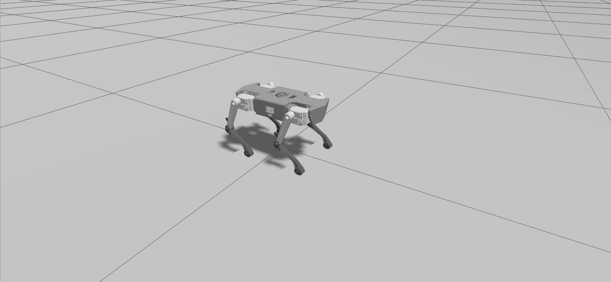
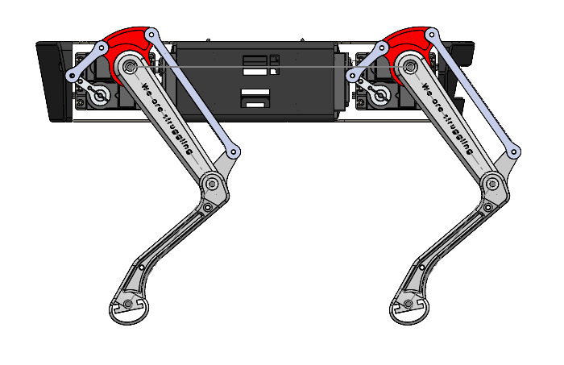
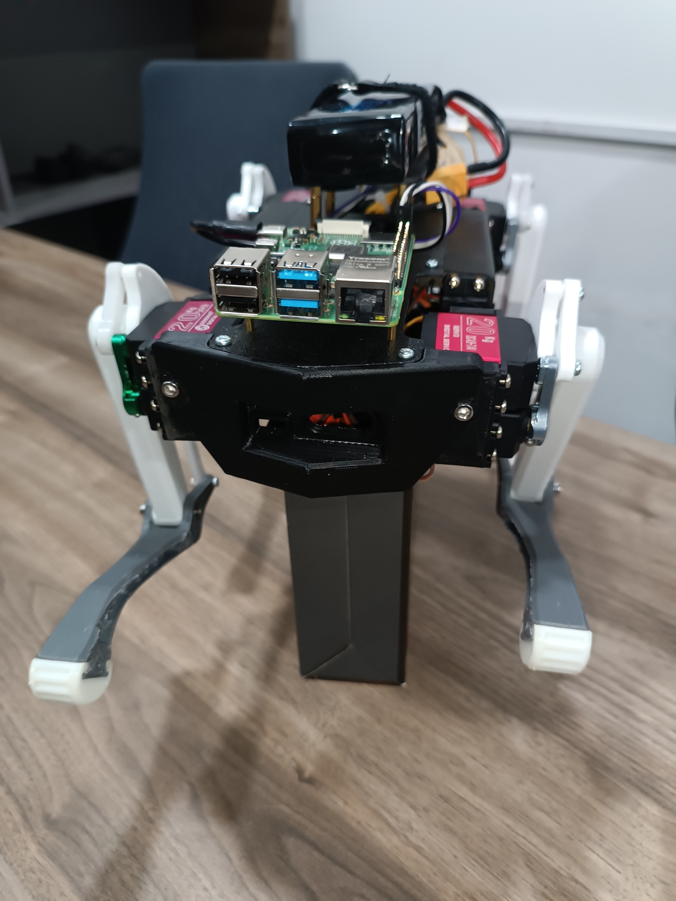
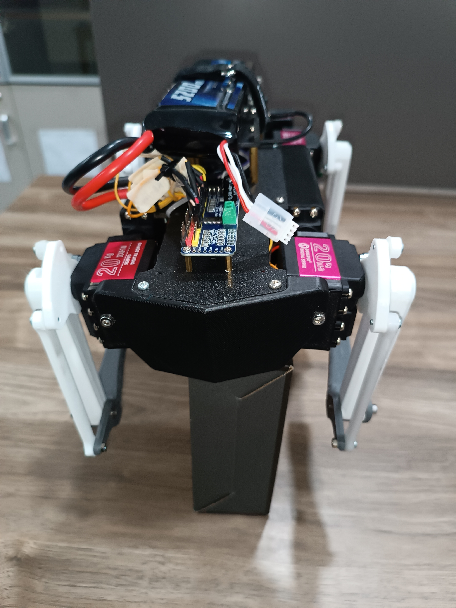
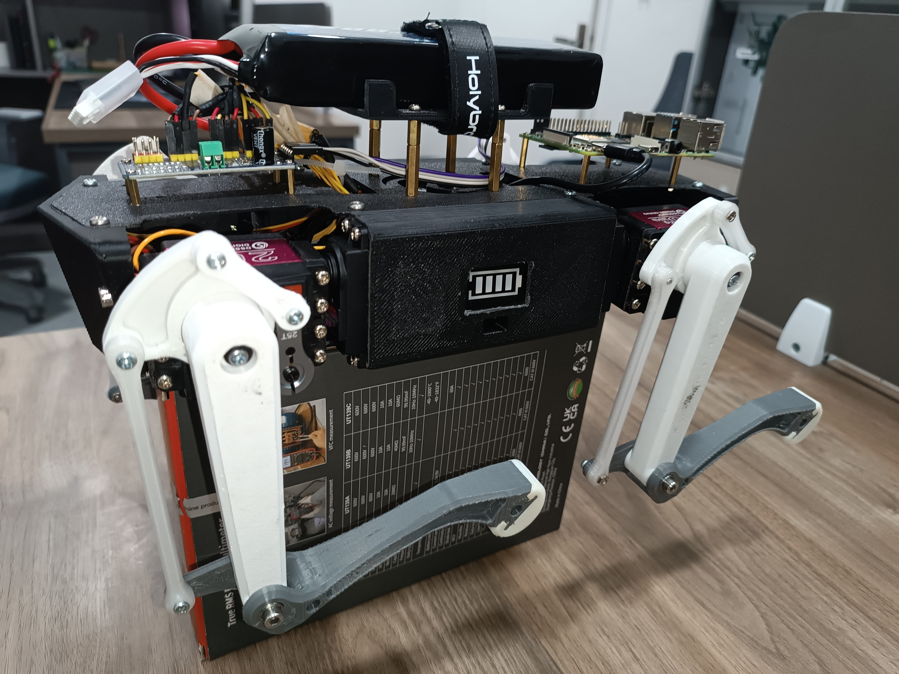
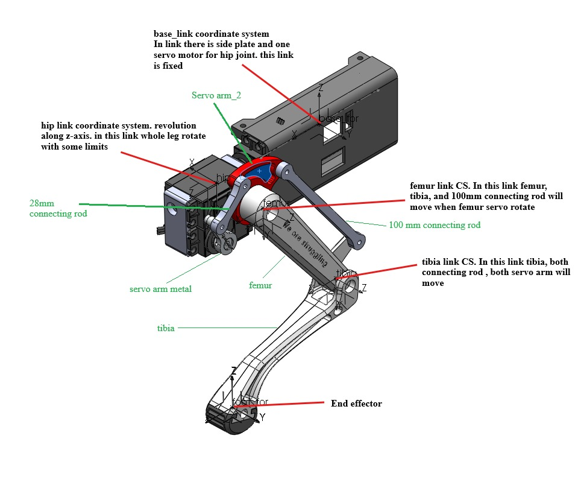

# Quadruped Robot — 12-DOF Electronics Design

A 3D-printed, 12-degree-of-freedom quadruped robot built as a legged-locomotion platform, with custom electronics for actuation and power distribution. It integrates a Raspberry Pi 4B, a PCA9685 I2C servo controller, and a multi-rail buck-converter power system sized against worst-case servo load.



**Features:**
- 12-DOF quadruped platform (4 legs × 3 joints: hip, femur/thigh, tibia/shin)
- Raspberry Pi 4B main controller with a PCA9685 I2C PWM servo controller
- Custom multi-rail power distribution sized via load-current analysis
- 3D-printed ABS/PLA chassis, compact benchtop footprint
- Dedicated cooling fan for the electronics bay

> This repository contains the electronics design, documentation and build photos. The gait and servo-control software is not included.

## System Overview

The robot is a four-legged platform with three actuated joints per leg (hip, femur and tibia), giving 12 degrees of freedom. A Raspberry Pi 4B is the main controller and talks to a PCA9685 16-channel servo controller over I2C (SDA/SCL), which generates the PWM signals for the 12 servos on channels 0–11. Power comes from a single 11.1 V, 5200 mAh LiPo pack, split across three buck converters: two high-current converters, one for the front six servos and one for the back six servos, and a third 5 V converter for the Raspberry Pi. A DC fan for the electronics bay is powered from the back-servo rail.


## Specifications

| Parameter | Value |
|---|---|
| Configuration | Quadruped, 12 DOF (4 legs × 3 joints) |
| Dimensions (L × W × H) | 306 × 204 × 180 mm |
| Frame material | ABS and PLA, FDM 3D-printed |
| Main controller | Raspberry Pi 4B |
| Servo controller | PCA9685 (I2C), channels 0–11 |
| Servos | 4 × MG996R (hips, ~11 kg·cm) and 8 × DS3218MG (femur and tibia, ~20 kg·cm) |
| Battery | 11.1 V, 5200 mAh LiPo |
| Cooling | 12 V DC fan |
| Software | Not included in this repository |

### Servo channel map (PCA9685)

| Channel | Joint | Channel | Joint |
|---|---|---|---|
| ch0 | Left front tibia | ch6 | Right front tibia |
| ch1 | Left front femur | ch7 | Right front femur |
| ch2 | Left front hip | ch8 | Right front hip |
| ch3 | Left back tibia | ch9 | Right back tibia |
| ch4 | Left back femur | ch10 | Right back femur |
| ch5 | Left back hip | ch11 | Right back hip |

Note that the PWM channels are grouped by body side (left 0–5, right 6–11), while the servo power rails are grouped front and back.

### Power budget

| Rail | Spec | Load |
|---|---|---|
| Buck 1 | 6.5 V @ 15 A | Front 6 servos |
| Buck 2 | 6.5 V @ 15 A | Back 6 servos and DC fan |
| Buck 3 | 5 V @ 3.5 A | Raspberry Pi 4 (3.3 V logic rail onboard) |
| **Battery (peak)** | **~16–17 A** | All-six-stalled worst case |

Worst-case current draw was modeled across idle, typical gait, and all-six-servo-stalled scenarios for both servo types (MG996R and DS3218MG), to size the buck converters and confirm battery draw margin. The full working is in the `Load_Calculation` sheet of [`docs/Hardware_Wiring_and_Load_Calculation.xlsx`](docs/Hardware_Wiring_and_Load_Calculation.xlsx).

## Hardware Design
### Mechanical
The chassis is a compact 3D-printed frame in ABS and PLA, sized 306 × 204 × 180 mm, housing the Raspberry Pi, servo controller, and power electronics centrally, with each leg's three servos mounted at the hip, femur, and tibia joints to drive the stance/swing gait cycle. ABS was used where impact resistance mattered most at the leg/joint mounts, with PLA for lower-load structural parts.




### Electrical architecture
- **Compute:** The Raspberry Pi 4B issues servo commands over I2C (pins 3 and 5 for SDA/SCL) to the PCA9685, which drives all 12 servos.
- **Power distribution:** The LiPo pack feeds three buck converters in parallel: two 20 A buck converters (6.5 V rails) for the front and back servo banks, and a 5 V converter for the Raspberry Pi.
- **Cooling:** A DC fan keeps the buck converters and compute within thermal limits under sustained servo draw.

Documentation:
- **BOM:** [`docs/BOM_Quad_dog.xlsx`](docs/BOM_Quad_dog.xlsx)
- **Wiring and load calculation:** [`docs/Hardware_Wiring_and_Load_Calculation.xlsx`](docs/Hardware_Wiring_and_Load_Calculation.xlsx)
- **Schematic export:** [`docs/Schematic.pdf`](docs/Schematic.pdf)

### Altium project
The schematic is designed in Altium Designer, see [`hardware/altium/`](hardware/altium/):
- `Block Diagram.SchDoc` — system-level power and signal architecture (power distribution, servo rails, controller, Pi)
- `Schematic.SchDoc` — detailed circuit schematic
- `Schlib2.SchLib` — custom schematic symbol library used in the design


## Repository Structure

```
12-DOF-Quadruped-Dog/
├── hardware/altium/   Altium project: block diagram and schematic, symbol library, output job
├── docs/              BOM, hardware wiring and load calculation workbook, schematic PDF
└── images/            Block diagram, 3D design, simulation render, build photos, walk demo GIF
```

## Build Photos
All photos of the assembled robot are in [`images/`](images).








## Walk Demo
The initial gait implementation was done by another team member.


## Author
This project is by the following team members and is in the algorithm development phase:
- Dr. Muhammad Ahmad Kamran (Team Lead), AITeC Islamabad
- Muhammad Huzaifa Rahim Malik (Electronics Design), AITeC Islamabad
- Muhammad Mohsin Razaqi (Mechanical Design), AITeC Islamabad
- Muhammad Awais Khan (Algorithm Design), AITeC Islamabad
