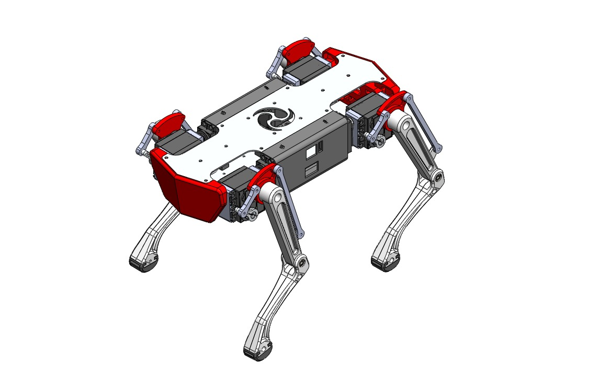
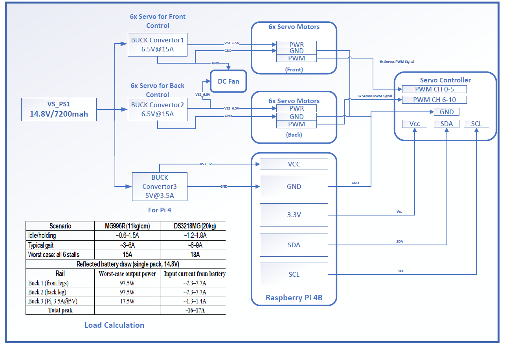
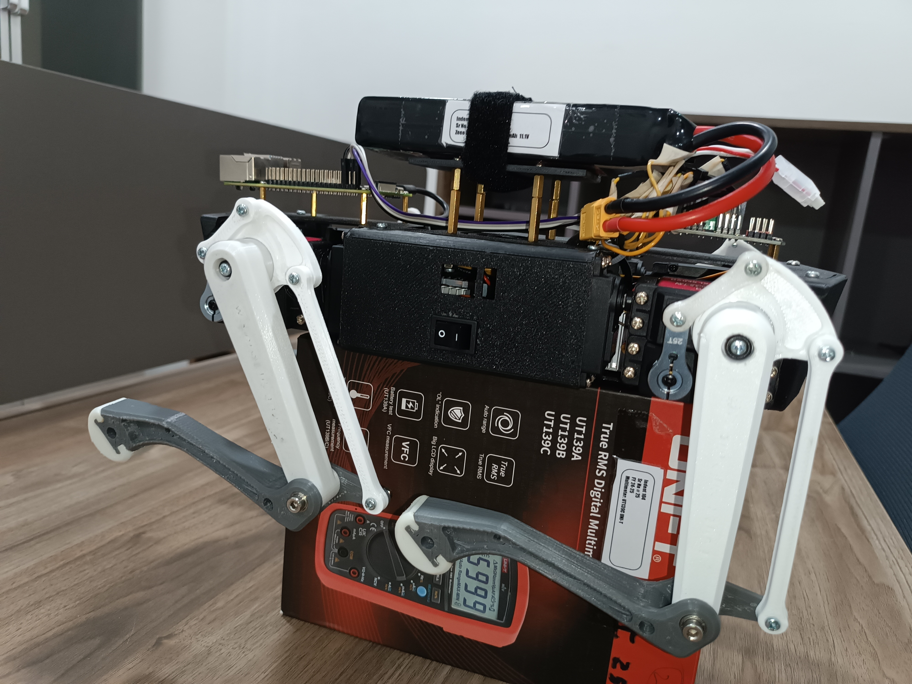
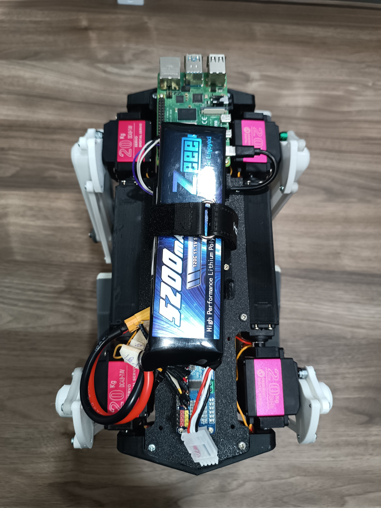

# Quadruped Robot — 12-DOF Electronics Design

Electronics and power-distribution design for a 3D-printed 12-degree-of-freedom quadruped robot (6 servos driving the front legs, 6 driving the back legs), controlled by a Raspberry Pi 4B.



**Mechanical Description:** 
- 3D Material: ABS
- Dimension:

## System Overview

- **Compute:** Raspberry Pi 4B as the main controller, communicating with a dedicated servo controller over I2C (SDA/SCL) and PWM.
- **Actuation:** 12 servo motors total — 6 for front-leg control, 6 for back-leg control — driven via a servo controller with two PWM banks (channels 0–5 front, 6–10 back).
- **Power architecture:** A single 11.1 V, 5200 mAh LiPo battery pack feeds three buck converters:
  - Buck 1 — 6.5V @ 15A for the front 6 servos
  - Buck 2 — 6.5V @ 15A for the back 6 servos
  - Buck 3 — 5V @ 3.5A for the Raspberry Pi 4 (with a 3.3V rail for logic)
- **Cooling:** A small DC fan provides dedicated cooling for the robot’s electronics.
- **System Power:** An 11.1 V, 5200 mAh LiPo battery powers the system for reliable and stable operation.
- **Load calculation:** Worst-case current draw was modeled for two candidate servo options (MG996R ~11kg·cm vs DS3218MG ~20kg·cm) across idle, typical gait, and all-six-stalled scenarios, to size the buck converters and battery draw (peak ≈ 16–17A reflected at the battery). Full working is in `docs/Load_Calculation.docx`
- **BOM:** The complete BOM is available at `docs/BOM_Quad_dog.xlsx`.



## Repository Structure

```
hardware/altium/    Altium project — schematic,  schematic library
docs/               Block diagram & schematics, load calculation,BOM,
images/             Block diagram, Original 3D Design images 
```

## Hardware Design
The schematic of 3D printed dog were designed in Altium Designer (`hardware/altium/`) and complete hardware is available at `docs/Hardware_Wiring.xlsx`:
- `Block Diagram.SchDoc` — system-level power and signal architecture (power distribution, servo rails, controller, Pi)
- `Schematic.SchDoc` — detailed circuit schematic
- `Schlib2.SchLib` — custom schematic symbol library used in the design

## Walk Demo
The gait implementation was done by another team member


## Quadrupled Dog Images
The complete pictures of assembled quadrupled dog is available at: (`images`)




## Author

Muhammad Huzaifa Rahim Malik — Designed the electronic architecture of a 3D-printed quadruped robot, including embedded control, power management, sensor integration, and communication systems.